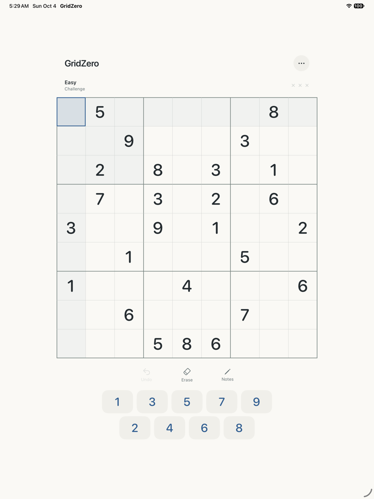
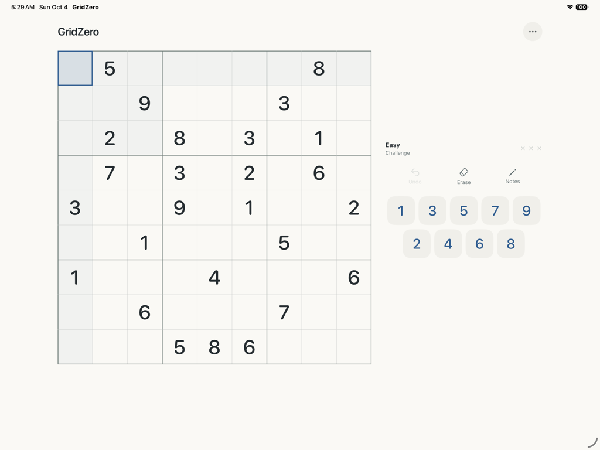

# Layout verification

Checked 2026-10-04 using Terminal-only tools.

## Geometry coverage

- 40 inventoried model profiles, 15 distinct display geometries.
- Every model checked in portrait and landscape with three conservative safe-area budgets: 240 model/orientation/inset cases.
- 2,960 additional window-size and breakpoint cases, plus Display Zoom checks.
- Square boards, in-bounds/nonoverlapping regions, minimum 44-point keys, and staggered geometry are asserted.

## Actual SwiftUI simulator checks

13 distinct native display geometries passed portrait, landscape, and rotation back to portrait. Each run checks all nine keys, board containment, tool touch targets, and actual note entry/undo. Models with the same display geometry share a representative run; this is not a claim of physically testing every device.

| Portrait display (points) | Simulator representative | Result |
|---|---|---|
| 390 × 844 | iPhone 16e | Passed |
| 393 × 852 | iPhone 16 | Passed |
| 402 × 874 | iPhone 16 Pro | Passed |
| 420 × 912 | iPhone Air | Passed |
| 430 × 932 | iPhone 16 Plus | Passed |
| 440 × 956 | iPhone 16 Pro Max | Passed |
| 744 × 1133 | iPad mini (6th generation) | Passed |
| 768 × 1024 | iPad mini (5th generation) | Geometry tests only |
| 810 × 1080 | iPad (9th generation) | Passed |
| 820 × 1180 | iPad (10th generation) | Passed |
| 834 × 1112 | iPad Air (3rd generation) | Geometry tests only |
| 834 × 1194 | iPad Pro (11-inch) (2nd generation) | Passed |
| 834 × 1210 | iPad Pro 11-inch (M4) | Passed |
| 1024 × 1366 | iPad Air 13-inch (M2) | Passed |
| 1032 × 1376 | iPad Pro 13-inch (M4) | Passed |

All native runs used iOS / iPadOS 27 simulators with an iOS 26 deployment target. The 768 × 1024 and 834 × 1112 older hardware profiles cannot boot the installed runtime. They passed the geometry tests and were additionally rendered at those sizes inside the iPad viewport harness.

## iPad window-size rendering

10 embedded safe-area viewports passed actual SwiftUI rendering and input checks on a 13-inch iPad: 320 × 480, 375 × 700, 480 × 620, 600 × 500, 640 × 480, 744 × 900, 768 × 1024, 834 × 1112, 980 × 700, and 1100 × 760. These are viewport-size checks, not automated Stage Manager window-drag gestures. Actual device rotation also exercises live layout changes.

The final single-window scene configuration was smoke-tested again on iPhone 16e and iPad Pro 13-inch. All three gameplay regression tests also passed on iPhone 16e after the responsive layout changes, including correct/rejected entries, three-strike retry, Classic checking, themes, notes, undo, and relaunch. The full matrix, window harness, raw screenshots, and XCTest result bundles remain under `build/layout-results/`. Temporary test simulators are shut down and deleted after each run.

## Visual review

Portrait iPhone screenshots are refreshed in `site/public/assets/`. Large iPads use a centered, size-capped notebook in portrait and a side-by-side board / keypad in landscape.

